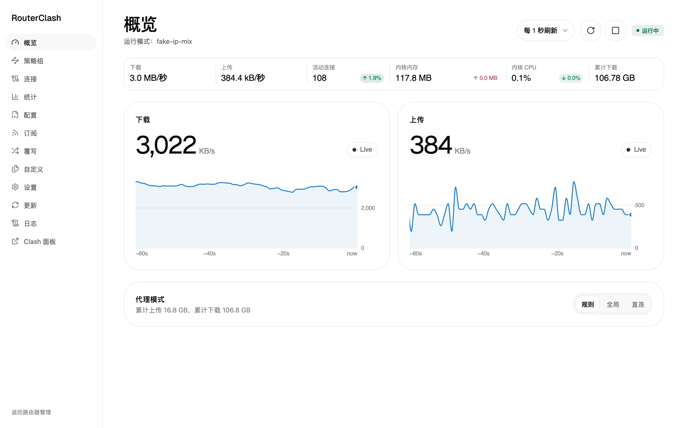
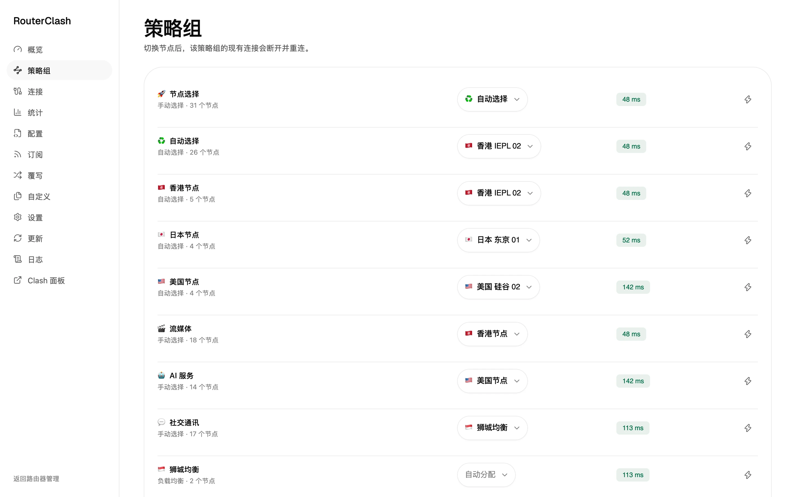
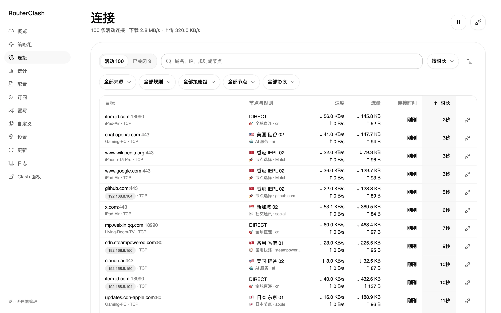
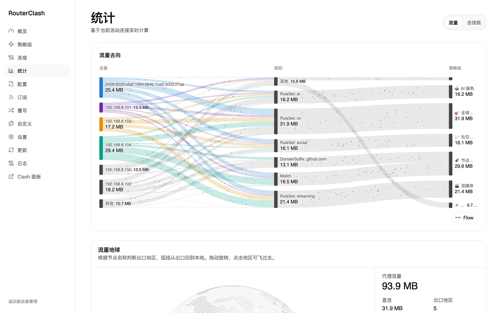
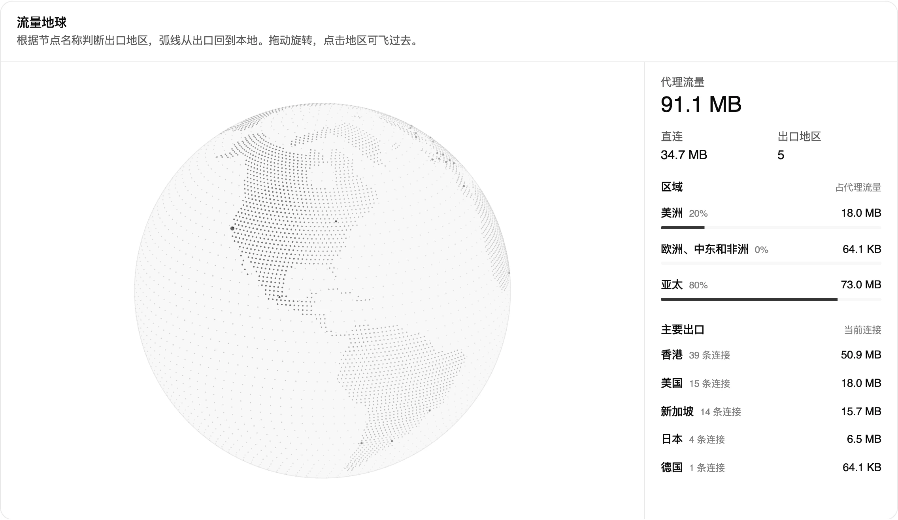
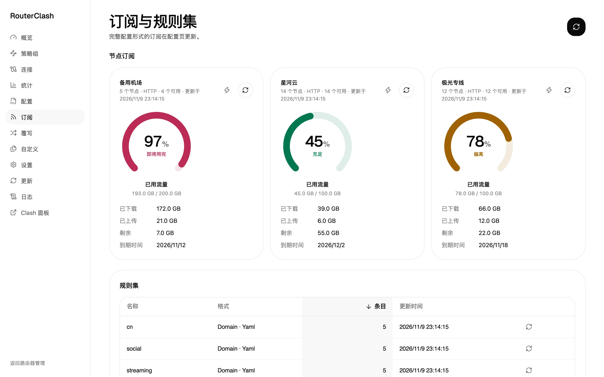
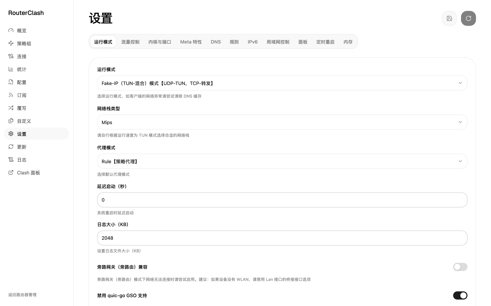

<div align="center">


# RouterClash

运行在 OpenWrt 上的 [Mihomo (Clash Meta)](https://github.com/MetaCubeX/mihomo) 客户端，带一套重新设计的 LuCI 管理界面

[](https://github.com/youtonghy/RouterClash/releases)
[](https://github.com/youtonghy/RouterClash/actions/workflows/check.yml)
[](LICENSE)
[](https://openwrt.org/)

基于 [vernesong/OpenClash](https://github.com/vernesong/OpenClash) 二次开发

</div>



## 目录

- [简介](#简介)
- [截图](#截图)
- [功能](#功能)
- [快速开始](#快速开始)
- [下载](#下载)
- [依赖](#依赖)
- [开发与构建](#开发与构建)
- [鸣谢](#鸣谢)
- [许可证](#许可证)

## 简介

RouterClash 是 [OpenClash](https://github.com/vernesong/OpenClash) 的一个分支。它沿用 OpenClash 成熟的透明代理、防火墙与配置处理逻辑，把 LuCI 页面换成了一个 React 单页应用，并围绕日常使用做了取舍：

- **新的管理界面**：概览、策略组、连接、统计、订阅等页面直接读取 Mihomo 控制器的实时数据，支持中英文，深浅色跟随系统。
- **断网保护（Kill Switch）**：内核未运行时阻止局域网设备绕过代理直连，默认开启，可一键临时放行。
- **更轻的功能面**：移除了流媒体解锁检测、Smart 内核、GEO 数据库定时更新、dnsmasq 转发与大陆白名单绕过等分支，只保留 Mihomo（Meta）内核。
- **默认面板**：内置 zashboard（默认）与 metacubexd。

包名与配置路径保持为 `luci-app-openclash` / `/etc/openclash`，可以直接覆盖安装在 OpenClash 之上并保留原有配置。

## 截图

<table>
  <tr>
    <td width="50%"><p align="center">策略组：行内切换节点、测速</p></td>
    <td width="50%"><p align="center">连接：按来源、规则、策略组、节点筛选</p></td>
  </tr>
  <tr>
    <td width="50%"><p align="center">统计：设备 → 规则 → 策略组流量去向</p></td>
    <td width="50%"><p align="center">流量地球：按出口地区汇总代理流量</p></td>
  </tr>
  <tr>
    <td width="50%"><p align="center">订阅：流量用量、到期时间与规则集</p></td>
    <td width="50%"><p align="center">设置：运行模式、DNS、IPv6、局域网控制等</p></td>
  </tr>
</table>

> 截图使用演示配置与模拟流量，节点与订阅均为虚构。

## 功能

| 页面 | 说明 |
|------|------|
| 概览 | 实时上下行速率曲线、活动连接、内核内存与 CPU、累计流量，切换规则 / 全局 / 直连 |
| 策略组 | 查看全部策略组与节点延迟，行内选择节点（会断开该组现有连接以立即生效），按策略组测速 |
| 连接 | 活动与已关闭连接，显示局域网设备名称，按来源、规则、策略组、节点、协议筛选与排序，单条或全部断开 |
| 统计 | 设备 → 规则 → 策略组流量桑基图、节点可用率、流量分布、出口地区地球与订阅用量 |
| 配置 | 多配置文件切换、在线编辑、上传，添加订阅（可选在线订阅转换） |
| 订阅 | 节点订阅的已用流量、剩余与到期时间，规则集条目与更新 |
| 覆写 | 模块化覆写，启动时按顺序叠加到配置上 |
| 自定义 | 前置规则、IPv4 / IPv6 绕过列表、防火墙脚本、流量探测 |
| 设置 | 运行模式（Fake-IP / Redir-Host，TUN / 混合）、DNS、IPv6、局域网访问控制、面板、定时重启、内存等 |
| 更新 / 日志 | 更新 Mihomo 内核（只重启内核进程）、备份与恢复，查看插件与内核日志 |

同时兼容 iptables（fw3）与 nftables（fw4）。

## 快速开始

### 一键安装

在路由器上以 root 运行（自动识别 opkg / apk 与 iptables / nftables，安装依赖并校验安装包）：

```shell
wget -qO- https://github.com/youtonghy/RouterClash/releases/latest/download/install.sh | sh
```

可选参数（通过 `sh -s --` 传入，或使用括号中的环境变量）：

| 参数 | 说明 |
|------|------|
| `-v, --version <tag>` | 安装指定版本，例如 `v0.49.002`（`OPENCLASH_VERSION`） |
| `-p, --proxy <prefix>` | GitHub 下载加速前缀，例如 `https://ghfast.top/`（`GH_PROXY`） |
| `--skip-deps` | 跳过依赖安装（`SKIP_DEPS=1`） |

```shell
wget -qO- https://github.com/youtonghy/RouterClash/releases/latest/download/install.sh | sh -s -- -p https://ghfast.top/
```

### 网页安装

1. 从 [Release 页面](https://github.com/youtonghy/RouterClash/releases) 下载安装包（opkg 系统用 `*.ipk`，apk 系统用 `*.apk`）；
2. 登录 OpenWrt 的 LuCI 后台，前往 **系统 → 软件包** 上传并安装；
3. 刷新或者重新登录页面，在 **服务 → RouterClash** 中导入订阅或上传配置文件并启动。

> 首次使用需要在 **更新** 页面下载 Mihomo 内核，请提前确认网络环境。

使用说明可参考 [OpenClash 使用手册](.github/skills/openclash-user-guide/SKILL.md)（来自上游，部分功能在本分支中已移除）。

## 下载

最新版本请前往 [Releases](https://github.com/youtonghy/RouterClash/releases/latest) 页面，按需选择对应的安装包：

| 安装包 | 适用系统 |
|--------|------|
| `luci-app-openclash_*.ipk` | 使用 opkg 的 OpenWrt（24.10 及更早） |
| `luci-app-openclash-*.apk` | 使用 apk 的 OpenWrt（25.12 及更新） |

每个 Release 同时附带 `install.sh` 与 `sha256sums.txt`。

## 依赖

一键安装脚本会自动处理以下依赖。

| 类别 | 依赖 |
|------|------|
| 必需 | bash、curl、ca-bundle、ip-full、ruby、ruby-yaml、kmod-tun、unzip、luci-base、luci-compat |
| 推荐 | kmod-inet-diag |
| 防火墙（nftables / fw4） | kmod-nft-tproxy |
| 防火墙（iptables / fw3） | iptables、kmod-ipt-nat、iptables-mod-tproxy、iptables-mod-extra、ipset |

## 开发与构建

### 前端

LuCI 页面由 `luci-app-openclash/web` 中的 React 应用构建，构建产物不提交到仓库，打包前需要先构建（CI 会为每个包构建）。详见 [web/README.md](luci-app-openclash/web/README.md)。

界面使用的 [Arc](https://collectui.pro) 组件（含付费的 Arc Pro）受许可限制，仓库里不含其源码：构建时用 `ARC_PRO_TOKEN` 从 registry 现拉到被忽略的 `src/components/arc`。没有 token 无法构建前端，但不影响安装已发布的包。

```bash
cd luci-app-openclash/web
npm install
npm run arc     # 需要 ARC_PRO_TOKEN（环境变量或 web/.env.local）
npm run dev     # 开发服务器，API 代理到 OC_RIG（默认 http://127.0.0.1:18080）
npm run build   # 输出到 ../root/www/luci-static/resources/openclash/app，已被 git 忽略
```

### 打包

插件与架构无关（`PKGARCH:=all`），ipk 可以不借助 SDK 直接打包：

```bash
bash luci-app-openclash/tools/build-ipk.sh dist   # 生成 dist/luci-app-openclash_<版本>_all.ipk，需要先构建前端
```

也可以把 `luci-app-openclash` 目录放进 OpenWrt SDK 或源码树的 `package/` 下，用 `make package/luci-app-openclash/compile` 编译（需要先在 `tools/po2lmo` 中 `make && sudo make install`）。apk 包即用 OpenWrt snapshot SDK 以这种方式构建。

### CI 与发布

- **Check**：每次推送与 PR 运行前端 lint、类型检查与构建（用 `ARC_PRO_TOKEN` 现拉 Arc 组件；来自 fork 的 PR 没有 secret，会跳过这一步）、Lua / Shell / Ruby 语法检查，以及 ipk 打包。
- **Release**：推送 `v<PKG_VERSION>` 标签（例如 `git tag v0.49.003 && git push origin v0.49.003`）后，校验标签与 `luci-app-openclash/Makefile` 中的版本一致，先构建前端，再打 ipk 与 apk，并发布 Release（附 `install.sh` 与 `sha256sums.txt`）。

也可以在 Actions 页面手动运行 `Release`（或 `gh workflow run release.yml -f version=0.49.003 -f publish=true`）：

- `version`：要构建的版本号（如 `0.49.003`），留空则使用 Makefile 中的 `PKG_VERSION`；只覆盖本次构建，不会提交到仓库；
- `publish`：勾选后在所选分支的当前提交上创建 `v<version>` 标签并发布 Release，该版本已发布时会直接失败；不勾选只构建产物。

## 鸣谢

### 上游项目

RouterClash 建立在 [vernesong](https://github.com/vernesong) 维护的 [OpenClash](https://github.com/vernesong/OpenClash) 之上。透明代理、防火墙规则、配置处理、内核管理等核心逻辑都来自 OpenClash 多年的积累，感谢 vernesong 与所有 OpenClash 贡献者。如果 RouterClash 对你有帮助，也欢迎支持上游作者：

<p align="left">
  <a href="https://ko-fi.com/H2H41G5LS" target="_blank"></a>
</p>

需要完整功能（流媒体解锁检测、Smart 内核等）或更稳定的长期维护，请使用 [OpenClash](https://github.com/vernesong/OpenClash)。

### 开源项目与数据

| 类别 | 项目 | 作者 / 组织 | 说明 |
|------|------|-------------|------|
| 上游 | [OpenClash](https://github.com/vernesong/OpenClash) | [vernesong](https://github.com/vernesong) | 本项目的基础 |
| 代码基础 | [Luci For Clash](https://github.com/frainzy1477/luci-app-clash) | [frainzy1477](https://github.com/frainzy1477) | OpenClash 的代码基础 |
| 内核 | [Mihomo](https://github.com/MetaCubeX/mihomo) | [MetaCubeX](https://github.com/MetaCubeX) | 代理内核（Clash Meta） |
| 控制面板 | [zashboard](https://github.com/Zephyruso/zashboard) | [Zephyruso](https://github.com/Zephyruso) | 默认内置面板 |
| 控制面板 | [metacubexd](https://github.com/MetaCubeX/metacubexd) | [MetaCubeX](https://github.com/MetaCubeX) | 内置面板 |
| 控制面板 | [Yacd-meta](https://github.com/MetaCubeX/Yacd-meta) / [yacd](https://github.com/haishanh/yacd) | [MetaCubeX](https://github.com/MetaCubeX) / [haishanh](https://github.com/haishanh) | 可选面板 |
| 控制面板 | [Razord-meta](https://github.com/MetaCubeX/Razord-meta) | [MetaCubeX](https://github.com/MetaCubeX) | 可选面板 |
| 订阅转换 | [subconverter](https://github.com/tindy2013/subconverter) | [tindy2013](https://github.com/tindy2013) | 在线订阅转换 |
| 规则模板 | [ACL4SSR](https://github.com/ACL4SSR/ACL4SSR) | [ACL4SSR](https://github.com/ACL4SSR) | 订阅转换规则模板 |
| GEO / IP 数据 | [meta-rules-dat](https://github.com/MetaCubeX/meta-rules-dat) | [MetaCubeX](https://github.com/MetaCubeX) | GeoIP / GeoSite 数据 |
| GEO / IP 数据 | [v2ray-rules-dat](https://github.com/Loyalsoldier/v2ray-rules-dat) | [Loyalsoldier](https://github.com/Loyalsoldier) | GeoIP / GeoSite 数据 |
| GEO / IP 数据 | [mmdb_china_ip_list](https://github.com/alecthw/mmdb_china_ip_list) | [alecthw](https://github.com/alecthw) | 中国 IP 列表 MMDB |
| 编辑器 | [CodeMirror](https://codemirror.net/) | [Marijn Haverbeke](https://github.com/marijnh) | 内置编辑器 |
| 前端 | [React](https://react.dev/)、[Vite](https://vite.dev/)、[Tailwind CSS](https://tailwindcss.com/)、[shadcn/ui](https://ui.shadcn.com/)、[Radix UI](https://www.radix-ui.com/)、[Base UI](https://base-ui.com/)、[Lucide](https://lucide.dev/)、[Motion](https://motion.dev/) | | 管理界面 |

## 许可证

本项目基于 [MIT License](LICENSE) 开源，保留上游 OpenClash 的版权声明。
